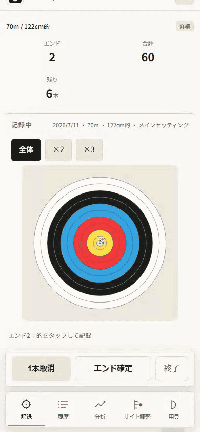

<div align="center">

# Archery Note

**プライバシー重視のアーチェリー練習ノート PWA**
**A privacy-first archery practice notebook (PWA)**

[](LICENSE)
[](https://eita115115.github.io/archery-note/)
[](CHANGELOG.md)
[](#プライバシー--privacy)

[**アプリを開く / Open the app**](https://eita115115.github.io/archery-note/) ・ [変更履歴 / Changelog](CHANGELOG.md) ・ [利用条件 / License](#ライセンス--license)

</div>

> **個人の非商用利用のみ / Personal, noncommercial use only.**
> 練習記録・研究・学習・趣味などの非商用目的では無料で使えます。商用利用（有償サービスへの組み込み、販売、業務での利用など）はできません。
> Free for personal, noncommercial use such as practice, research, study, and hobbies. Commercial use is not permitted. See [License](#ライセンス--license).

<div align="center">



</div>

## Archery Note とは / What is Archery Note?

得点・着弾位置・サイト値・用具・射形をひとつのアプリで記録し、「サイトを動かすか、まだ待つか」「次に何を練習するか」を根拠つきで示すアーチェリー練習ノートです。アカウント不要・広告なしで、データは端末の外に出ません。

Archery Note records scores, arrow positions, sight marks, equipment, and shooting form in one place, and explains the next step with evidence: whether to move the sight or wait, and what to practice next. No account, no ads, and your data never leaves your device.

## 主な機能 / Features

### 記録 / Recording

| 機能 / Feature               | 説明 / Description                                                                                                                                                                                                                                                       |
| ---------------------------- | ------------------------------------------------------------------------------------------------------------------------------------------------------------------------------------------------------------------------------------------------------------------------ |
| 🎯 **得点記録 / Scoring**    | 的をタップして着弾位置と得点を同時に記録。線かみは矢の実際の太さ（用具の矢径）で判定し、境界線は高得点側（WA規則）。 / Tap the face to record position and score. Line cutters are judged with the real arrow diameter; ring lines belong to the higher zone (WA rules). |
| 📐 **的面 / Faces**          | 単的・三つ目的・フィールド的 / Single, vertical triple, and field faces                                                                                                                                                                                                  |
| 🔄 **ラウンド / Rounds**     | フリー練習と複数距離ラウンド / Free practice and multi-distance rounds                                                                                                                                                                                                   |
| 🌤️ **条件メモ / Conditions** | 天気・風向・風速 / Weather, wind direction and speed                                                                                                                                                                                                                     |

### 分析 / Analysis

| 機能 / Feature                                    | 説明 / Description                                                                                                                                                                                                                                                                                                           |
| ------------------------------------------------- | ---------------------------------------------------------------------------------------------------------------------------------------------------------------------------------------------------------------------------------------------------------------------------------------------------------------------------- |
| 📊 **グルーピング / Grouping**                    | 全部の矢で計算した RMS 半径（95% 区間つき）が正式な値。外れ値候補は MCD 法と厳密な検定で判定し、除いた値とロバスト推定は参考として並べます。 / The official metric is the all-arrow RMS radius with a 95% interval. Outlier candidates come from MCD plus an exact test; screened and robust values are shown for reference. |
| 🔭 **サイト調整 / Sight adjustment**              | 本数を考慮した統計で「動かす / 保留 / 維持」を判定し、誤差に応じて控えめな量を mm とクリックで提案。横風は誤差として扱います。 / Decides move / hold / keep with statistics that account for the number of arrows, and suggests a shrunken amount in mm and clicks. Crosswind counts as uncertainty.                         |
| 📏 **サイト予測 / Sight-mark prediction**         | 重力・空気抵抗・目と矢と的の高低差を含む弾道に当てはめて、未測定の距離のサイト値を予測します。 / Predicts marks for unmeasured distances by fitting the ledger to a trajectory with gravity, drag, and eye/arrow/target heights.                                                                                             |
| 📈 **推移 / Trends**                              | 日・週・距離・用具ごとの得点とグルーピングの推移 / Score and grouping trends by day, week, distance, and equipment                                                                                                                                                                                                           |
| 🤖 **AI 射形トラッキング（ベータ）/ Form (beta)** | MediaPipe Pose による端末内の射形分析。既定 OFF / On-device form analysis with MediaPipe Pose. Off by default                                                                                                                                                                                                                |

### 用具・データ / Equipment & Data

| 機能 / Feature                   | 説明 / Description                                                                                                                                                          |
| -------------------------------- | --------------------------------------------------------------------------------------------------------------------------------------------------------------------------- |
| 🏹 **用具管理 / Equipment**      | 弓・矢（主要シャフトのカタログ内蔵）・サイト・チューニング情報 / Bow, arrows (built-in shaft catalog), sight, and tuning notes                                              |
| 💾 **バックアップ / Backup**     | JSON のバックアップ・復元 / JSON backup and restore                                                                                                                         |
| 🔬 **研究用 CSV / Research CSV** | 全射・外れ値候補を除いた値・ロバスト推定・旧方式の比較列と `stats_version` を出力 / Exports all-arrow, screened, robust, and legacy comparison columns with `stats_version` |
| 📴 **オフライン / Offline**      | Service Worker による完全オフライン動作 / Fully offline via Service Worker                                                                                                  |

## 計算の根拠 / How the numbers are computed

数式・前提・検証結果はすべて文書にしています。The formulas, assumptions, and validation are documented:

- [計算の中核の作り直し / Math core rebuild](docs/design/math-core-rebuild.md) — 採点・サイト判定・弾道・サイト予測 / scoring, sight decisions, ballistics, sight prediction
- [グルーピング統計 grouping-v3](docs/design/grouping-stats-v3.md) — 全射 RMS・MCD による外れ値候補・ロバスト推定と、その検証基準 / all-arrow RMS, MCD outlier screening, robust estimation, and acceptance criteria

主な検証結果（固定シードのモンテカルロ）/ Key results (fixed-seed Monte Carlo):

- 中心が合っているのに「サイトを動かす」と出る割合: 約 5%（旧方式は 6 本で約 91%） / False "move the sight" rate: about 5% (previously about 91% with 6 arrows)
- 正常な矢を外れ値候補にする割合: 1〜2% 以下、入力順を入れ替えても結果は同じ / False outlier flags: at most 1–2%, invariant to input order
- 実測していない距離のサイト値予測の誤差: 約 1mm（旧方式の直線・二次近似は 2〜9mm） / Sight-mark prediction error at unmeasured distances: about 1 mm (previously 2–9 mm)

研究で CSV を使う場合は、`stats_version` が `grouping-v3` の行だけを比べてください（以前の出力とは `group_*` などの意味が違います）。
When using the CSV for research, compare only rows with `stats_version` = `grouping-v3`.

## AI 射形分析（ベータ）/ AI Form Tracking (Beta)

MediaPipe Pose の 33 ランドマークから射形メトリクスを算出します。処理はすべて端末内で完結し、映像は送信されません。評価は自分の過去の記録との比較が基準で、撮影角度による誤差があるため毎回同じ角度で撮ることを勧めています。

Form metrics are computed on-device from MediaPipe Pose's 33 landmarks; video is never uploaded. Results compare you with your own past sessions. Film from a consistent angle.

| メトリクス / Metric            | 基準値 / Reference |
| ------------------------------ | ------------------ |
| 押し手角度 / Bow arm angle     | 172° (±9)          |
| 引き手角度 / Draw arm angle    | 152° (±14)         |
| 肩の落ち / Shoulder drop       | 0.072 (±0.056)     |
| アンカー位置 / Anchor position | 0.4 (±0.112)       |
| 頭のオフセット / Head offset   | 0.088 (±0.072)     |
| 体幹の傾き / Torso lean        | 0.21 (±0.045)      |
| 引き力線 / Draw force line     | 0.072 (±0.064)     |

フェーズ自動検出 / Automatic phase detection: IDLE → SETUP → DRAWING → ANCHORING → FULL_DRAW → RELEASE → FOLLOW

## 使い方 / Quick Start

URL を開くだけで使えます。ホーム画面に追加すると、ネイティブアプリのように動作します。
Just open the URL. Add it to your home screen for an app-like experience.

> **https://eita115115.github.io/archery-note/**

ローカル開発 / Local development (Node.js 22.19+):

```bash
npm install
npm run check:all
npm run test:e2e
```

## 技術スタック / Technology Stack

| カテゴリ / Category       | 技術 / Technology                                                                                                  |
| ------------------------- | ------------------------------------------------------------------------------------------------------------------ |
| フロントエンド / Frontend | Vanilla JS (no framework), HTML, CSS                                                                               |
| PWA                       | Service Worker, Web App Manifest                                                                                   |
| 統計・物理 / Math         | 独自実装: MCD・F 検定・Hotelling T²・3 次元 RK4 弾道 / Custom: MCD, F tests, Hotelling T², 3D RK4 ballistics       |
| AI / 射形分析             | MediaPipe Pose (on-device)                                                                                         |
| テスト / Testing          | Node の検証スクリプト、モンテカルロ検証、Playwright (E2E) / Node check scripts, Monte Carlo validation, Playwright |
| リンター / Linting        | ESLint, Prettier                                                                                                   |
| ネイティブ / Native       | Capacitor (Android/iOS ready)                                                                                      |
| ホスティング / Hosting    | GitHub Pages                                                                                                       |

## プライバシー / Privacy

- 🔒 データは端末内に保存 / Data stays on your device
- 🚫 アカウント不要・広告なし・トラッキングなし / No account, no ads, no tracking
- 🤖 AI 処理も端末内 / AI runs on-device
- 📡 GitHub Pages はアプリ本体を配信するだけ / GitHub Pages only serves the app

ブラウザや端末のストレージを消すと、バックアップしていない記録は失われます。定期的に JSON バックアップを保存してください。
Clearing browser or device storage deletes records that are not backed up. Save a JSON backup regularly.

## 開発の経緯 / Project history

Archery Note は 2026 年 6 月から開発しています。Build Week では成長ダッシュボードと根拠つきの練習提案を追加しました（[概要](docs/build-week/PROJECT_DESCRIPTION_JA.md) / [Description](docs/build-week/PROJECT_DESCRIPTION_EN.md) / [開発ログ](docs/build-week/CODEX_DEVELOPMENT_LOG.md)）。v126 で採点・統計・サイト判定・弾道の計算の中核を作り直しました。各版の変更は [CHANGELOG](CHANGELOG.md) にあります。

Development started in June 2026. The Build Week extension added a growth dashboard and evidence-based practice suggestions. App v126 rebuilt the math core for scoring, statistics, sight decisions, and ballistics.

## コントリビュート・セキュリティ / Contributing & Security

- 貢献方法 / Contributing: [CONTRIBUTING.md](CONTRIBUTING.md)
- 脆弱性の報告 / Security: [SECURITY.md](SECURITY.md)（公開 Issue に脆弱性の詳細を書かないでください / Do not post vulnerability details in public issues）

## ライセンス / License

**[PolyForm Noncommercial License 1.0.0](LICENSE)**

- ✅ 個人の非商用利用（練習記録、研究、実験、学習、趣味）/ Personal noncommercial use (practice, research, experiments, study, hobbies)
- ✅ 非営利の教育機関・研究機関などによる利用 / Use by noncommercial organizations such as educational and public research institutions
- ✅ 上記の目的での改変・再配布（ライセンス条文と `Required Notice` の行を添えること）/ Changes and redistribution for those purposes, with the license terms and the `Required Notice` line
- ❌ 商用利用（販売、有償サービス・製品への組み込み、営利目的の業務での利用など）/ Commercial use (selling, embedding in paid services or products, for-profit business use, etc.)

正確な条件は [LICENSE](LICENSE) の条文が優先します。The terms in [LICENSE](LICENSE) govern.

v126 までの版（2026-11-12 のコミット 66391ff まで）は Apache License 2.0 で公開されていました。その版をその条件で入手した方は、引き続きその条件で利用できます。以降の版は PolyForm Noncommercial License 1.0.0 です。
Versions up to app v126 (commit 66391ff, 2026-11-12) were released under the Apache License 2.0 and remain usable under it by those who obtained them. Later versions are licensed under the PolyForm Noncommercial License 1.0.0.

第三者のソフトウェア・素材はそれぞれのライセンスに従います（[THIRD_PARTY.md](THIRD_PARTY.md)、[NOTICE](NOTICE)）。
Third-party software and assets keep their own licenses.
