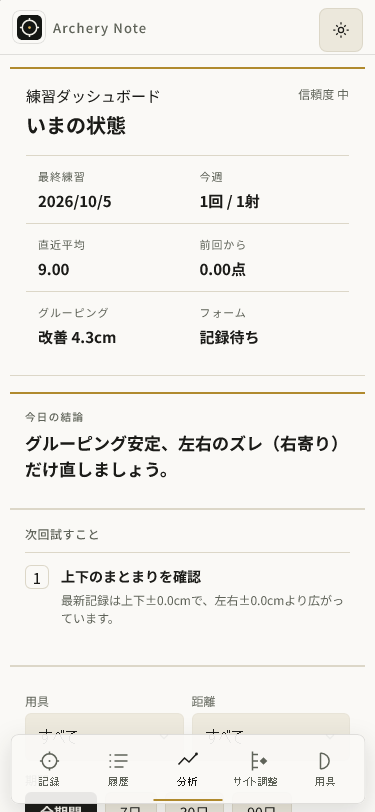
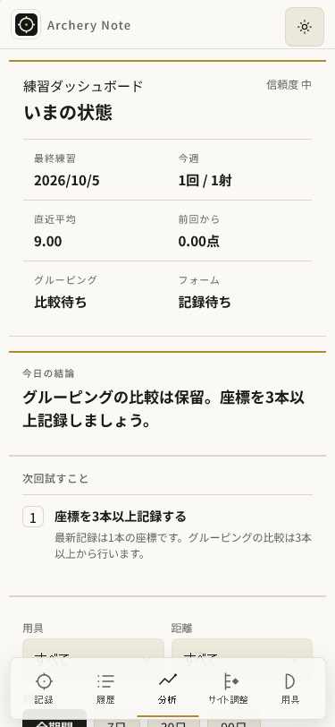
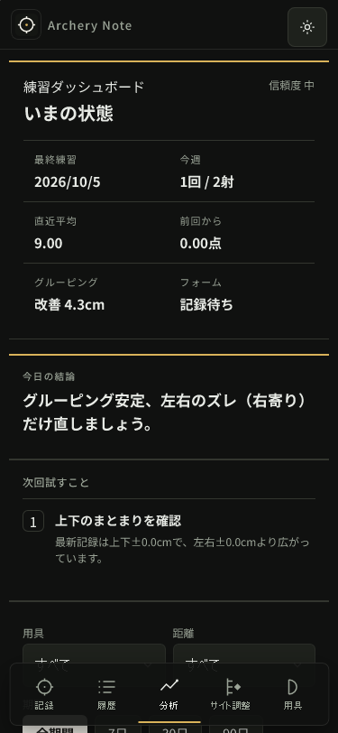
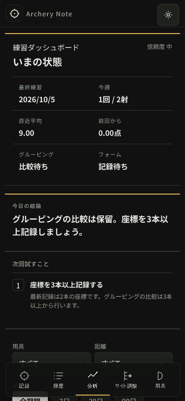
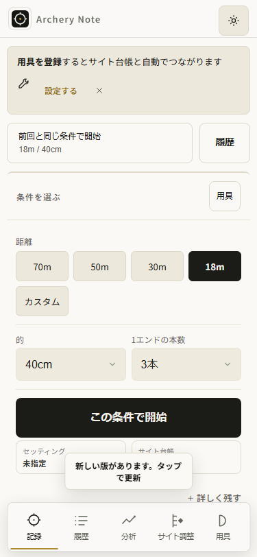
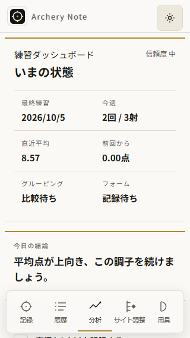

# 分析と履歴のグルーピング判断を揃える — AN075

前回AN074は監査の進捗。基点local2aeda7c0bec1b4fa87d9c476c9cc2af351b3f440、公開110/sourcef967d12e96bdb113c8e1747236dcd3394d53f42d。実Linux110の40UI/実public25byte、架空旧3＋native保存と独立reviewを根拠に、一小タスクとして誤解釈を修正する。全承認継続、費用/個人情報不使用。

## 設計と選択

1. **共通の最低座標資格をconsumerで確認する**。生のRMS/score/cache/座標は保ち、最新と前回が比較可能なときだけ改善を語る。採用。
2. dashboard表示だけを隠す。集計値・KPI・結論・履歴助言の矛盾が残るため不採用。
3. RMS数学や全分析行を変更する。正しいraw値/score母集団まで変わるため不採用。

brainstorming/writing-plans/archery-note/test-driven-development/verificationを適用。得点・座標・履歴・分析を結ぶ、成長を誤読させない、完全local、毎回の判断を助ける4product gatesを確認。包括承認の範囲で設計と実装を続ける。新しいlayout/機能追加ではなく既存解釈の整合であり、追加のvisual質問/再承認は不要。

純関数を40-analysis-physics.jsの説明consumerより前に置き、45/49/50の共通資格は`total>=3 && n>=3 && finite(rr)`とする。trの既存APIをwrapperとして保ち、履歴comparisonも共通化。資格は既存最低本数であって有意性の保証ではない。方向は各既存比率1.3/1.35を保ち、有限・非負・表示1桁で違いが読めるときだけ提示する。

最新少数座標のdashboardは比較待ち、KPIは最新比較待ち＋過去の資格ある最小、結論はscoreの上/下傾向があるならそれを保ち、それ以外は座標不足を明示。次回提案に3本以上の座標を集める具体的理由を出す。period/conditionはRMS/中心の母集団だけ資格を揃え、回数/本数/平均点/最高合計を維持。履歴conditionInsights/shapeNoteの良好・方向・中心の助言も資格/可読精度を守るが、風の物理推定/条件memo/用具情報は保つ。

PB換算達成の注記は次の別タスク。採点/数学、sessionMetrics/cache、round/同条件、保存/schema、style/layout/handlers、依存、SWactivationは変更しない。公開時だけ版markersを現行から一括更新する。

## 実装順と受入

1. 実40/45/49/50の関数を読む。実robustStats/scoreAt生成の0/1/2/3/6本、座標欠損/数値文字列、少数最新/前回、得点変化/valid3+・方向ゼロ/正差、period/condition score保持をregressionでredにする。旧synthetic unitstatsに実契約n/totalが欠ける場合はfixtureにその契約だけ明記する。
2. 上記pure資格/可読方向をconsumerへ適用。得点行/rawstatsはそのまま保持。focused regressionと既存check:analysis/check:todays-resultでgreenにし、失敗は元出力を残して原因を直す。
3. 320/375明暗Chrome/WebKitの実UI、native記録→終了→結果→分析→履歴→保存reloadを検証。全40countcasesの数値/文言、代表375前後画像、旧3/座標/score一致/errors0を保存する。元110のredを新成功へ置き換えない。
4. checkall/lint/format/生成全E2E、最低座標資格とscore母集団の独立readonlyレビュー。現版と次版を確認しversion:bump/check:version、最終資産で検証後commit/push、既存無料Pages CI/実Linuxartifact/実public25byte/所有旧110context更新banner/記録保存/offlineと新実native分析を確認する。
5. 公開確認後だけAN075pass＋非空evidence。旧74task/全acceptance/共有hiddenlock保持、docs/progress/historyに失敗/成功/限界/nextを記録する。

大目標active。実iPhone/VoiceOver/統計的有意性/fullmotion/INP/GPU/実射/巨大履歴/WKstrictOffline/旧閉鎖profileの回復を今回のdesktop証拠から主張しない。失敗したownedprocess/contextは原因と元状態を保ち、観測timeoutだけでrestartしない。

## Candidateで見つけた読みやすさ

原寸の320明暗画像で長い保留説明の末尾がnavへ重なった。所有Chromeの同じ生成111を別readonly contextで対照: paragraph426〜502.5/nav488〜560、clearfalse。観測JSON/PNGを保存し正常に閉じた診断contextであり、元失敗の回復とはしない。copyを「グルーピングの比較は保留。座標を3本以上記録しましょう。」へ短縮、n1/2の320/375明暗E2Eへparagraph.bottom<=nav.top−4と横幅を追加する。計算/資格/layoutは同じ。長文時の全E2Eが動いている間はsandbox/distを上書きせず、終了後に最終copyを生成して必要チェックをやり直す。

## 最終候補の検証

source `97e89934953e4ed6224664c40d49eddaddd99645`、版111。公開基点110のimmutable関数へ最終43チェックを適用すると19fail。候補は43green。資格は共通のtotal/n>=3とfinite RMS、方向は元の比率を保ち0.1cm表示で差が読める場合だけ提示する。scoreの上昇/低下は座標不足でも得点を根拠に提示できる。

所有Node22.19/sandboxで実行。rootと元repoの共有node_modulesへinstall/ci/updateはしていない。`run.cjs`はsystem Nodeで起動し、内部でowned22を使う。最終runtimeの全E2E後に追加した最後のコミットはJSONのファイル保存とDOM文言の取得だけで、runtime/fixture/assertionは同じ。最終246件の検証に加え、その変更後のChrome21/WK21を実行して40セルと2native JSONを実際に保存した。公開CIは最後のテストも含めて再実行する。

```text
npm run check:analysis
Analysis core characterization checks OK
Robust median reuse checks OK
Grouping interpretation checks OK (43 checks; real scoring/statistics, score populations retained)

npm run check:all
Archery Note checks OK (v111)
check-globals OK (14 files, 1239 unresolved refs all accounted for)
UI smoke checks OK (chrome.exe)
PWA asset checks OK
PWA update flow checks OK
Storage contract checks OK
Storage round-trip checks OK
Save debounce checks OK
Version alignment checks OK
Distribution checks passed:14 structures/names/order/source/regeneration; gzip JS 197665→140024 bytes; cross-script fixtures

npm run lint
exit 0
npm run format:check
All matched files use Prettier code style!

npm run test:e2e:dist -- --workers=4
246 passed (3.8m)
npm run test:e2e:dist -- tests/e2e/analysis-grouping-evidence.spec.js --workers=2
21 passed (24.4s)
npm run test:e2e:dist -- tests/e2e/analysis-grouping-evidence.spec.js --config=playwright.webkit-owned.config.cjs --workers=2
21 passed (29.2s)

invariants.cjs
PASS: only declared interpretation functions changed; math/cache/scoring/coordinates/storage/handlers/layout exact; version111 only SW/storage markers; dependencies/old74tasks/allacceptance/sharedlock exact
```

raw出力は `artifacts/analysis-grouping-v111/analysis-final.txt`、`check-all-compact-final.txt`、`lint-evidence-final.txt`、`format-evidence-final.txt`、`full-compact-final.txt`、`chrome-evidence-final.txt`、`webkit-evidence-final.txt`。生成圧縮量は配布チェックの値であり、INP改善の測定ではない。

最終40セルの数値・実DOM文言・旧3/reload/score一致/errors0は [matrix.json](evidence/analysis-grouping-v111/matrix.json)、native375の実touch→9点保存→終了→結果→分析→履歴→reloadは [native.json](evidence/analysis-grouping-v111/native.json)。0本では直近の得点記録、1/2本は比較待ち、3/6本は既存の比較、全score母集団を保つ。期間/条件のRMS母集団だけを資格で絞る。旧3点のRMSのengine差約0.0639cmは旧110でも観測済みで、数学を変更した証拠ではない。

独立readonly `review_analysis_grouping_fix` は5c20432実装を2aeda7c0に対照しCritical/Importantなし。minorのunitstats6/12/18本契約を3e859b5で訂正、再reviewで残りなし。8fe5c64の短文copy/settled bounds、97e89934のJSON保存差分もblockingなし。独立review時にpublic成功を仮定していない。

初unitの重複windTextによるSyntaxError、owned22からwrapperを起動したnpm不在、存在しないID selectorによる9failed/12passed、checkallの一時EBUSY、長文copyの320重なりは元出力を保持。fixture/API/selectorを具体的に訂正し、ownedUIprofileのlock解除を確認してから再実行した。最初の長文full246passed(6.4m)は最終copyの可読性証拠として使わず、最終copyで別full246passed(3.8m)。JSON attachment bodyだけだった初期focused出力はdurable数値JSONとして使わず、ファイル保存後の最終21+21から採取した。

## 原寸の前後画像

前はAN074の実Linux110、後は上記sourceのowned生成111。375の明暗dashboard/KPI/history、native summary/analysis、320明暗dashboardの後10画像を原寸で表示し、改善の誤断定が消え、本文がnavの上に収まることを目視した。全120PNGの目視ではない。[copies.json](evidence/analysis-grouping-v111/copies.json) はraw画像からのbyte同一コピー10件。

| 場面      | 前110                                                                                              | 後111                                                                                             |
| --------- | -------------------------------------------------------------------------------------------------- | ------------------------------------------------------------------------------------------------- |
| 375明/1本 |  |  |
| 375暗/2本 |   |   |

375 KPIは最新比較待ち＋資格ある過去最小4.3cmを併記し、過去最小を最新と取り違えない。履歴は座標不足の比較保留を保ち、別の良好助言を重ねない。PB換算到達の注記欠落は残っており、次の別タスク。

## 公開111の確認

承認済みの既存PUBLIC repoへsource `97e89934953e4ed6224664c40d49eddaddd99645` をmainにpushした。[CI37253017560](https://github.com/eita115115/archery-note/actions/runs/37253017560) はvalidate/deployともsuccess、Linuxの最後のテストも `246 passed (5.1m)`。実Pages artifact11321214071の26regularfilesを所有path内へ安全抽出し、実Linux/実public25資産をbyte一致、元保持ブラウザが読んだ最初の新document15資産とSWの14canonical scriptsも一致した。markers111整合、dependency/SWactivation変更なし。

```text
gh run watch 37253017560 --interval 30 --exit-status
exit 0; validate/deploy success
CI E2E
246 passed (5.1m)
extract.py
PASS:actual Linux26 regular files extracted within owned proof directory/no links
parity.cjs
PASS:all25 actual Linux/public111 assets byte-identical; all15 held-update first-document warm bodies match Linux
held-public.cjs
PASS: same real public110→111 context, active update blocked/native finish/old4 retained, 320 newstart first native arrow/correction/native exit/next arrow, offline SWreload exact / two-arrow pending in summary+history / old4 and finish5 exact
```

元public110で架空デモ旧3を読み、実touchで記録中1本を作り、normal max-age600の15資産をwarmした。同じcontextのままpublication424772ms < fresh597000ms、record中updateは非表示でpracticeexact。終了で旧3＋新1の4件を保存しbannerをタップ、111/cache111only/旧4exact、updatecheckpoint433942ms。reset/recreate/retrytapなし。

更新後320で新開始→native中心1本→right調整3回（保存debounceはpoll）→選択解除→次矢、cur2と旧4をofflineSWreloadでexact、終了後5件の旧4＋cur2が一致。結果と履歴は2本の比較保留、分析dashboard/KPI比較待ち、提案は座標3本以上、方向の誤提案なし。実デモではscore上向きの結論は正しく残る（`trend-up`）。履歴の保留行bottom376.859375 < footer439でfivepoints clear、reload保存exact、pageerrors0。成功後元browser/contextを閉じた。予行local110→111の成功をpublicとして数えていない。

数値/CI/同contextのpractice証拠は [release.json](evidence/analysis-grouping-v111/release.json)、[public-update.json](evidence/analysis-grouping-v111/public-update.json)、[public25-parity.json](evidence/analysis-grouping-v111/public25-parity.json)。公開banner/summary/analysis/historyの4原寸画像も表示・目視し、同byteコピー、代表14画像のコピーが一致した。公開320の結論がscore上向きでもグルーピング比較待ちを保つことを確認。




AN075のみ公開後にdone/pass＋非空evidenceへ更新した。旧74taskobjects/全acceptance/共有hiddenlock保持を確認し、進捗と履歴台帳を更新した。大目標active。次の別タスクはPB換算到達時の注記保持。実iPhone/VoiceOver/fullmotion/INP/GPU/実射/巨大実履歴/WKstrictOffline/旧閉鎖profile回復は未証明。

2026-10-12 JSTの継続時にもmainは同source、CIはsuccess、実Linux/public25byteを再照合し一致した（`parity-reconfirmed-output.txt`）。これは新しい110→111更新の実行ではなく、上記公開検証の証拠保持と現在公開の再確認。今回の完了notesはlocalcommitで保存し、アプリの新しいdeployや追加版bumpはしない。
