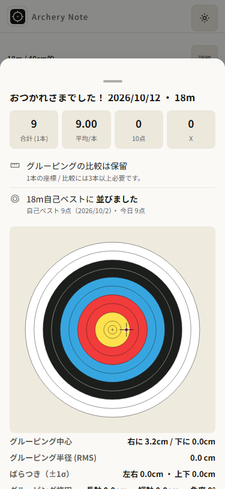
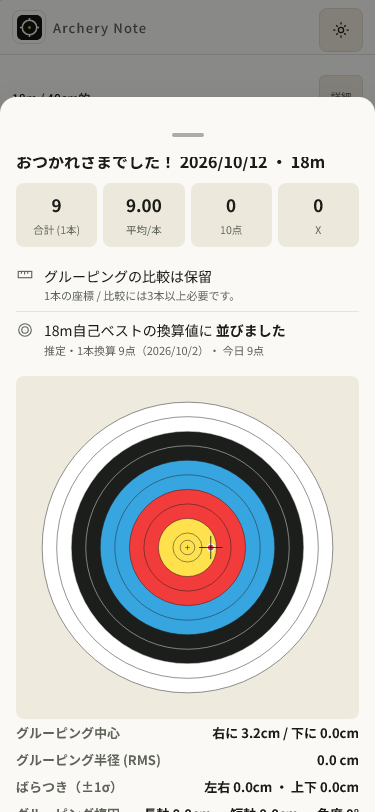
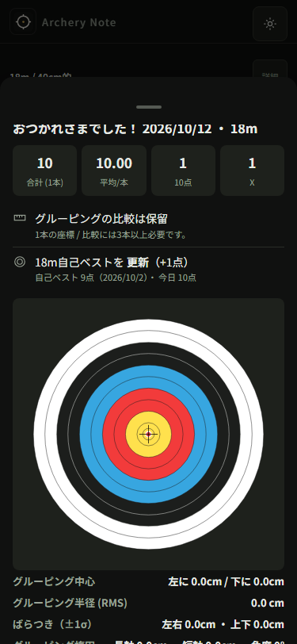
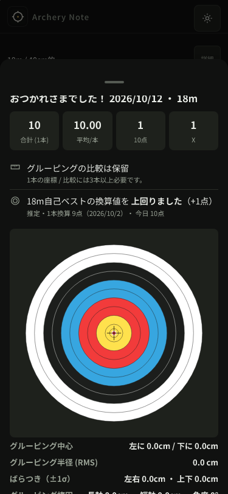

# 自己ベストの換算値を達成後も明示する — AN076

前回AN075は公開111と保存/UI/CIの証拠を完成した進捗。基点local49bb1d46d5c2f67b99ba613ebc9cc3b2c6c35f64、公開source97e89934953e4ed6224664c40d49eddaddd99645/v111。今回の一小タスクは、AN074で再現したPB換算到達後の注記欠落。包括承認継続、無料の既存PUBLIC Pages/所有架空fixtureだけを使い、費用・個人情報は使わない。

## 設計

原因は50-record-viewのtodaysResultPersonalBestRowHtmlで、推定・本数換算の注記が未達成のelse分岐にのみあること。49のcomputePersonalBestDistanceはmethod/bestTotal/todayArrowsをすべて返しており、計算側の欠落ではない。

1. **rendererで比較方法を全結果に表示する（採用）**。avg-projectedの主文を「自己ベストの換算値まで／に並びました／を上回りました」にし、詳細に「推定・○本換算 ○点（日付）・ 今日／この日 ○点」を常に出す。pace近いの説明は未到達時だけ既存どおり。exact-countのHTMLは現状と同一に保つ。
2. 到達時にも末尾へ注記を足すだけ。換算なのに主文の「自己ベスト更新」が実記録更新と混同されるため不採用。
3. PBを同本数だけに制限する。既存の比較/計算/母集団を変えてしまうため不採用。

得点と過去記録を結び比較方法を明示する、成長の誤読を防ぐ、完全local、日々の結果を理解できる、の4product gatesを確認。archery-note/brainstorming/writing-plans/systematic-debugging/TDD/verificationを適用。ユーザーの全承認の範囲にある最小表示修正で、追加の設計承認やvisual質問は不要。自分で仕様を確認し、比較method/本数/日付/値/今日とこの日の扱いに未定義やplaceholderがないことを確認した。

## 順序と受入

1. 旧111の計算とrendererを使い、換算/同本数×未達/並ぶ/超える、今日/この日、近いpace/日付/数値/非破壊のfocused回帰を追加し、本来の注記欠落でredにする。計算・exact-count HTMLは旧111と一致を確認する。
2. 変更は50の上記rendererだけ。49/PB計算/条件/score/rawstats/座標/保存/cache/schema/handlers/style/layout/依存/SWactivationを保つ。markersは現版を確認し一括bumpする。
3. Chrome/WK320/375明暗×換算/同本数×3結果の24条件ずつ、終了→summary→履歴→reloadで旧3/座標/採点一致/errors0と実表示JSONを保存。native320/375の新開始→中心arrow→終了→history/reloadも別確認。375前後代表画像を原寸表示、コピー同byteを確認。該当行をscrollして読み、横overflowやfooterの重なりを確認する。
4. check:todays-result/checkall/lint/format/生成全E2E、immutable差分の独立review。全markers整合。承認済みpush/CI実Linuxartifact/public25byte/元所有111contextの記録中update保留→終了banner→112更新/旧記録保持/offline/新native換算結果を検証する。
5. 公開後のみAN076done/pass＋非空evidence。旧75taskobject/全acceptance/共有hiddenlockを保ち、progress/ledgerへ変更ファイル/失敗も含む検証/限界/nextを書く。

大目標active。最低座標資格を統計的有意性としない。実iPhone/VoiceOver/fullmotion/INP/GPU/実射/巨大履歴/WKstrictOffline/旧閉鎖profile回復をdesktop証拠から主張しない。所有process/contextの観測timeoutだけでrestartしない。

## 実装と候補検証

実装6a4209e、marker-only112 4373653、reviewerのminorに対応した2本換算のunit差分6dabcff6ab73996e71693da348a271c9e1659cff。runtime変更は50のtodaysResultPersonalBestRowHtmlだけ。換算below/tie/aboveを明示し、同本数HTMLは旧111のsnapshotと同一。その他全tracked scripts/数学/PB計算/cache/scoring/座標/storage/handlers/layoutはASTとsourceで同一、SW/storageはmarker112だけ、依存/旧75taskobjects/全acceptance/sharedhiddenlock保持を確認した。

旧111のpure rendererはtieで換算値表示がないためred。最終UI回帰は14failed/12passed(12.4s): projected12＋native2が欠落コピーでfail、exact-count12はpass。初実行はtestのglobalThis.db参照がlexical letを読めず24setupfail＋native2copyfail、storageからの実データ読取へ訂正した。次の20fail/6passは320exact6の履歴をnearestへscrollしfooter下へ置いたharness6failを含む。centerへ読み位置を合わせると14/12になり、アプリのlayout/scroll処理は変えていない。元failure出力は残す。

artifactのsource invariantが不存在app-scripts.jsonを読んだENOENT、inline -e修正のshell quoting SyntaxError、再ENOENTも記録。git ls-filesで不存在を確認し、実在のindex/manifest/全scripts比較へartifact harnessだけ修正、source invariantは成功した。これらをアプリの失敗や修正と扱わない。

```text
node tools/check-todays-result.js
Personal best copy checks OK (18 real computed cases; exact-count HTML/calculation preserved; projection and pace notes)
Todays-result pure-function checks OK (weeklyDiff / stabilityTrend / personalBest / growthStreaks)

npm run check:all
Archery Note checks OK (v112)
UI smoke checks OK (chrome.exe)
PWA asset checks OK
PWA update flow checks OK
Storage contract checks OK
Storage round-trip checks OK
Save debounce checks OK
Version alignment checks OK
Distribution checks passed:14 structures/names/order/source/regeneration; gzip JS 197718→140070 bytes; cross-script fixtures

npm run lint
exit 0
npm run format:check
All matched files use Prettier code style!
npm run test:e2e:dist -- tests/e2e/personal-best-projection.spec.js --workers=4
26 passed (10.7s)
npm run test:e2e:dist -- tests/e2e/personal-best-projection.spec.js --config=playwright.webkit-owned.config.cjs --workers=4
26 passed (16.8s)
npm run test:e2e:dist -- --workers=4
272 passed (3.7m)
invariants.cjs
PASS:only PB renderer changed;all other scripts/math/PB/cache/scoring/coordinates/storage/handlers/layout exact;markers112 only;old75tasks/allacceptance/dependencies/sharedlock exact
```

checkallとChromefocusedはminorの2本unit追加前、最終unit18/lint/format/全272は追加後、runtimeは同じ。Chromefocusedは候補111marker、WKと全272は最終112marker。最終48セルJSONはChromeの全272出力とWK26から採取し、24conditions×2engines、summary/historyの今日/この日、実点数・本数・採点/座標/旧3/reload/errors0を残す。native320375×2enginesの4記録も別保存。raw `artifacts/personal-best-v112/` にred/unit/checkall/lint/format/chrome/webkit/full/invariants/local-updateを保持。

独立readonly reviewer `review_personal_best_projection` はimmutable49bb1d4..4373653のCritical/Importantなし。minor: projected1本だけの回帰では本数固定1を検出できない。6dabcffでcomputed2本×3relation×2dayLabelを追加し、再reviewで解消/残る指摘なし。reviewerはtest/build/CI/publicを実行せず、primaryの証拠を別に検査する。

所有local111→112予行は同contextの記録中update保留/nativefinish4/banner/cache112only/旧4exact、320native入力→調整→解除→次矢cur2/offlineSWreload/finish5/旧4と矢exact/summary-history推定2本換算/errors0で成功。localをpublicと数えない。生成圧縮量は配布チェックの値であり、INP改善測定ではない。

## 原寸画像と保存証拠

[matrix.json](evidence/personal-best-v112/matrix.json) の48セルと [native.json](evidence/personal-best-v112/native.json) の4nativeを保存。代表10PNG（旧111375明tie/暗above、最終112同375summary/history、320明above/暗tie、375native summary/history）を原寸表示して目視、rawコピーの全byte一致は [copies.json](evidence/personal-best-v112/copies.json)。すべてのPNGの目視を主張しない。

| 場面                           | 前111                                                                                         | 後112                                                                                                     |
| ------------------------------ | --------------------------------------------------------------------------------------------- | --------------------------------------------------------------------------------------------------------- |
| 375明・1本9点で換算値に並ぶ    |       |                 |
| 375暗・1本10点で換算値を超える |  |  |

## 公開112と元contextの回復

source/main `6dabcff6ab73996e71693da348a271c9e1659cff`、[CI38158744620](https://github.com/eita115115/archery-note/actions/runs/38158744620) のvalidate/deploy成功。実Linux E2E **272 passed (5.7m)**、artifact **11709683442**（sha256:8d8d0ce75ef0644ed49fc934e2eb44a7c2dfd51b5a59792b15a68257233cbd3c）を26regularfiles・リンクなし・所有dir内へ安全抽出。実Linux/public25資産byte一致、元更新documentの15bodyとSW canonical14も一致。CIのNode action/Ubuntu移行annotationは残るがjob成功、workflowは今回変更していない。

元public111は旧3架空デモ＋native1/15warmmaxage600。publication **456098ms < 597000ms**、updatecheckpoint **459063ms**。記録中update保留/finish4/banner/112cacheonly/旧4exact、320native1→3rightnudge保存poll→解除→native次矢cur2/offlineSWreload/finish5旧4と矢exact。summaryの推定2本換算は元scriptで確認済み。

続く分析の即時DOM読取で比較待ちassertがfalseとなり、元processはexit1を保持したままbrowser/contextを残した。failure画像にはダッシュボードの比較待ちが見えており、同contextのinspector観測ではinsightStripにも比較待ち、opacity1/animations0/保存5件exact/errors0。原因を確定せず、アプリ変更もしない。resume helper初回はinsightStripが2要素のstrict violation（操作前）でexit1、元querySelectorと同じfirstを指定して訂正。font/2rAF後DOM待機し、同context・reset/記録retapなしで分析資格/履歴pending五点hit/footerclear/換算2本注記/5件reloadexactまで成功し、browser閉鎖。元失敗を新fresh成功で置換していない。最初のofflinecheckpointはfailure前の元script assertを通過した範囲の証拠で、checkpoint rawJSONを後から捏造しない。

追加のpublic4枚と元failure1枚も原寸表示し、全代表15PNGをbyte同一で保存。public summary/historyは読み位置へcenter scrollした画像で、初期シート全体の可視性を主張しない。分析画像はdashboard表示、下方insightStripはJSONで確認。元エラー/回復/CI/公開資産を[release.json](evidence/personal-best-v112/release.json)、[public-update.json](evidence/personal-best-v112/public-update.json)、[public-inspection.json](evidence/personal-best-v112/public-inspection.json)に保存。

```text
CI validate/deploy: success
272 passed (5.7m)
PASS:all25 actual Linux/public112 assets byte-identical; all15 held-update first-document warm bodies match Linux
PASS:CI validate/deploy/Linux272 passed (5.7m);public25/held15/canonical14;publication456098ms<fresh597000ms;original111→112 context/old records exact/offline/projected2 notes/errors0;original DOM failure retained/same-context recovery/no reset or record retap;5 public images copied exactly
```

公開証拠後にAN076done/pass＋非空evidence。変更ファイルはscripts/50-record-view.js、tools/check-personal-best-copy.js/check-todays-result.js、tests/e2e/personal-best-projection.spec.js、markers4箇所＋lockrootmetadata、計画/証拠/画像/progress/tasks/ledger。公開後のnotesはlocal commitで保存し、同じappの再deployはしない。旧75task/全acceptance/sharedhiddenlock保持。次は別runで公開記録フローの性能/操作性監査。費用・個人情報不使用、大目標active、physicalphone/fullmotion/INP/GPU/実射/巨大実履歴/WKstrictOffline/旧閉鎖profilesは未証明。
